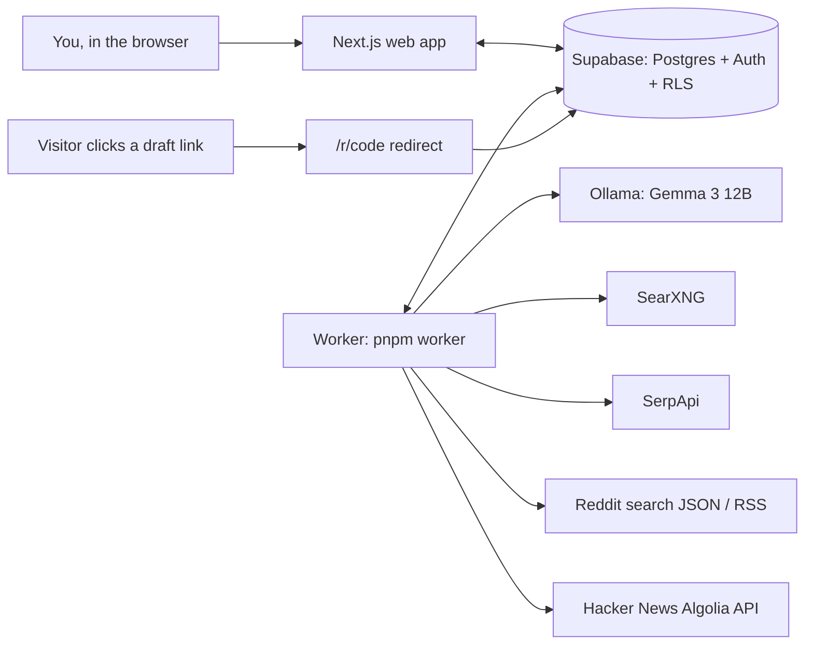

# Scout

**You built the app. Scout finds the users.**

Scout is a self-hosted web app for indie developers. Add your app and Scout's agent,
running on open-weight Gemma models, finds the threads where people describe the problem
your app solves, scores them for real buying intent, and drafts honest replies that help
first and disclose that you built the thing. You read, edit, copy, and post yourself.
**Scout never posts anything.**

Built for the [Hacktoberfest Open-Source AI Challenge, Week 3: Slow and Steady](https://dev.to/challenges/hf26)
(#hf26challenge). First test project: [GlamVault](https://try-glamvault.vercel.app/), a
personal beauty collection manager; second: Sloth Roll, an iOS app that turns screenshots
into calendar events, map pins, and expenses.

> Screenshot: projects page with Run now and the runs table — _placeholder_
>
> Screenshot: inbox with a lead card and its draft — _placeholder_
>
> Demo video (90 s): _link placeholder_

## Why "Slow and Steady"

Marketing is the chore indie developers put off. Finding the five Reddit threads a week
where someone asks for exactly your app means reading hundreds that don't. Scout does the
searching, reading, and first-draft writing while you do nothing: press **Run now**, walk
away, come back to an inbox of drafts. A run takes 10-30 minutes on a laptop, because the
models run locally and Scout is polite to every site it reads. Slow is fine; you weren't
going to do it anyway.

## Open pieces that make it work

| Piece | What Scout uses it for | License |
|---|---|---|
| [Gemma 3 12B](https://ai.google.dev/gemma) via [`gemma3:12b`](https://ollama.com/library/gemma3) | plans search queries, scores every hit, writes every draft and venue suggestion | [Gemma Terms of Use](https://ai.google.dev/gemma/terms) |
| [Ollama](https://ollama.com) ([GitHub](https://github.com/ollama/ollama)) | runs Gemma locally behind an OpenAI-compatible API (`lib/llm/ollama.ts`) | MIT |
| [SearXNG](https://github.com/searxng/searxng) | self-hosted metasearch for web results (`docker-compose.yml`) | AGPL-3.0 |
| [Next.js](https://nextjs.org), [Supabase](https://supabase.com), [Zod](https://zod.dev) | web app, Postgres + auth + row-level security, validation of every LLM reply | MIT / Apache-2.0 / MIT |

Why open weights:
- **No per-run cost.** A run makes about 30-50 model calls (1 plan, 10-30 scoring
  batches of 5 hits, 15 drafts, 1 venue list, plus retries). On a hosted API that's a bill per run; on a
  laptop it's electricity.
- **Your data stays local.** Your app's positioning, the threads you're eyeing, and your
  drafts never go to a model provider.
- **Tunable and swappable.** Models are env settings behind an `LLMProvider` interface. We
  measured 4B vs 12B on the same 42 leads and switched scoring to 12B because it rejected
  off-topic posts that 4B kept (Dev log, 2026-10-23).
- **Self-hostable end to end.** Ollama + SearXNG + Supabase (self-hostable) + this repo.

## Partner tech

- **Gemma (Best Use of Gemma):** every LLM step is Gemma 3 12B through Ollama: query
  planning in English and Spanish, intent/relevance/self-promotion scoring with Zod-checked
  JSON, drafting under product rules (≤ 120 words, disclosure, no link unless allowed),
  and manual venue ideas. Every output is validated, retried once, then skipped.
- **SerpApi (Best Use of SerpApi):** Google results from the past month for web queries,
  and the Reddit fallback (`as_sitesearch=reddit.com`) when Reddit refuses unauthenticated
  search (`lib/sources/serpapi.ts`). Budgeted per run; skipped cleanly without a key.

## Guardrails

- **Never posts.** No platform write APIs, anywhere. You copy the draft and post it.
- **Disclosure required.** A draft without "I built…" (or the Spanish equivalent) is
  rejected and retried; one over 120 words too.
- **Links only where allowed.** Drafts include a link only when the venue's link policy
  allows it; otherwise "happy to share the link".
- **Venue cooldown.** The inbox warns when you posted in the same venue in the last 7 days.
- **Quotas.** 3 runs per user per day; failed runs don't count.
- **Polite reading.** Per-source rate limits, timeouts, an honest User-Agent, Reddit RSS at
  1 request per minute.
- **No competitor spam.** Posts where the author launches their own app are dropped, so
  you don't reply to fellow builders with a pitch.

## How it works

1. **Sign in** with email + password (Supabase Auth). Every route except `/sign-in` and
   the email-confirmation callback redirects to sign-in when signed out (`proxy.ts`).
2. **Projects**: list, create, edit, delete your apps at `/projects`. Each project stores
   name, URL, description, audience, problems, English/Spanish keywords, tone, and region.
   Row-level security means you only ever see your own projects and their data.
3. **LLM provider**: `lib/llm` talks to Ollama's OpenAI-compatible API. `completeJSON`
   pulls JSON out of the reply (plain, in prose, or in a code fence), validates it with
   Zod, retries once, then throws a typed `LLMOutputError`.
4. **Dev LLM page** at `/dev/llm` (dev only): send a prompt to `SCORER_MODEL`, see the
   reply and latency.
5. **Run now** (projects page) inserts a `queued` run. Limit: 3 runs per user per UTC day
   (failed runs don't count), one active run per project; runs left are shown next to the
   button. The runs table under each project polls every 5 s while a run is queued or
   running (hits, leads, plan / search / score / draft times) and hints to start the
   worker when a run stays queued over 30 s. **Run history** (`/projects/[id]/runs`) lists
   date, status, duration, the queries used (expandable, with hits and errors per query),
   hits, leads, and errors.
6. **Worker** (`pnpm worker`) polls `runs` every 5 s, claims one queued run at a time,
   checks that Ollama (with the needed models) and SearXNG are up (otherwise the run fails
   with a message saying what to start or pull), and runs the pipeline:
   - **plan**: `DRAFTER_MODEL` (gemma3:12b) turns the project profile into 10-20 queries,
     English and Spanish, each tagged `reddit`, `hn`, or `web` (falls back to the project's
     keywords if the model fails).
   - **search**: Reddit, Hacker News (Algolia), SearXNG, and SerpApi (Google, past month).
     Each source has a timeout, a User-Agent, and its own rate limit. Reddit searches by
     relevance within the last month. Reddit tries
     `search.json`; on 403 it switches to `search.rss` (1 request/minute, 5 per run); after
     that, Reddit queries run on SerpApi restricted to reddit.com (no time filter, because
     Google ignores the site restriction with one). SerpApi is skipped when `SERPAPI_KEY`
     is unset.
   - **dedupe**: URLs normalized (tracking params, fragments, trailing slashes, reddit
     hosts) and dropped if already a lead for the project (dismissed ones included).
     App-store listings and the project's own site are dropped; hits older than 30 days too.
     Undated Reddit threads get an estimated date from their base-36 post id (a line fit
     through the run's dated Reddit posts), so years-old threads from web search fail
     the 30-day rule. The estimate is only used for filtering; leads store real dates.
     Keyword gate: a hit must contain one of the project's keyword phrases, or two distinct
     keyword words, in its title or snippet (so project keywords now matter).
   - **score**: `SCORER_MODEL` (default gemma3:12b) scores batches of 5 hits: author type
     (person or publisher), `self_promo` (the author is showing or launching something they
     made), relevance and intent (0-10), and a reason. Kept if a person wrote it, it is not
     self-promotion (scorer flag, or a launch title such as "I built an app…", "Show HN",
     "hice una app": `SCOUT.launchTitlePatterns`), relevance ≥ 6, and intent ≥ 5. Venues are upserted
     (subreddit, Hacker News, or domain) and leads inserted.
   - **draft**: `DRAFTER_MODEL` (gemma3:12b) writes one reply per undrafted lead (up to 15
     per run, highest intent first, leads older than 30 days skipped). The reply answers
     the person first, in their language, mentions the app in one or two sentences with a
     disclosure ("I built ..."), and includes the link only if the venue's `link_policy`
     is `allowed` (otherwise "happy to share the link"). Every draft gets a tracking link
     `/r/<code>`: it logs a click (project, venue, draft, referrer) and redirects to the
     project URL with `utm_source=<platform>&utm_medium=community&utm_campaign=scout&
     utm_content=<venue slug>`; a bare project URL in a draft is swapped for it.
     Over 120 words or no disclosure
     means a retry, then the lead is skipped. Saved as a pending draft; the lead becomes
     `drafted`.
   - **venues**: once per run the drafter suggests up to 8 places without search APIs
     (TikTok/Instagram hashtags, YouTube niches, Facebook group types, newsletters), each
     with why and a caption or outreach message. New names only; stored as manual venues
     with a pending draft.
   - The run row gets `queries` (each with where it ran, hit count, errors), `hits_found`,
     `leads_kept`, `step_durations` (plan, search, score, draft, venues), and `done` or
     `failed` with the error.
7. **Inbox** (`/projects/[id]/inbox`): tabs Leads, Manual venues, Posted, Rejected. Each
   card shows the thread link, source, venue, scores, reason, venue rules, and the draft
   in an editable textarea. Copy copies the edited text; Approve, Mark posted (stamps the
   draft's `posted_at` and the venue's `last_posted_at`), and Reject save the edited
   text. A card warns when its venue was posted in within the last 7 days. Scout never
   posts anything.
8. **Overview** on the projects page: new drafts, posted this week, last run time.

Not built yet: schedules, clicks per venue on the overview, onboarding auto-fill.
Any page error shows a "Something went wrong" screen with Try again (`app/error.tsx`).

## Architecture



The web app only reads and writes the database: queue a run, read leads and drafts,
approve or mark posted. The worker polls the `runs` table, does all model and search work,
and writes results back.

```
app/          Next.js routes (thin). (auth)/sign-in, auth/confirm, projects/,
              projects/[id]/inbox, projects/[id]/runs, r/[code] (tracking redirect),
              error.tsx, dev/llm
components/   ui/ primitives (Button, Field, TagInput); auth/, projects/, runs/, inbox/, dev/
lib/
  config.ts   env (Zod-validated) + all constants (models, quotas, limits)
  db/         Supabase clients: server (cookies), browser, service (service role);
              auth.ts (getSessionUser/requireUser), session.ts (proxy refresh),
              projects.ts (queries), projectInput.ts (form schema),
  llm/        LLMProvider interface, OllamaProvider, extractJSON, typed errors
              runs.ts, inbox.ts (user queries, RLS); runQueue.ts, scoutStore.ts
              (worker, service role)
  llm/        LLMProvider interface, OllamaProvider, extractJSON, typed errors;
              prompts/ (profile, planQueries, score, draft, manualVenues),
              schemas/ (queryPlan, score, draft)
  sources/    reddit, hackernews, searxng, serpapi adapters -> Hit; http (UA, timeout,
              403/429 -> SourceBlockedError), rateLimit, venue, dates, text
  scout/      planQueries, search (lanes + reddit fallback), dedupe, redditAge, keywords,
              rules (age, thresholds, skip domains), score, keepLeads, draft,
              manualVenues, trackedLink, health (preflight), log
  cooldown.ts venue cooldown rule (7 days)
  utm.ts      UTM URLs, short codes, project URL -> tracking link
  links.ts    /r/<code> resolve + click logging (store injected; lib/db/linkStore.ts)
worker/       index.ts (poll loop, claim, finish/fail), runScout.ts (timed steps)
searxng/      settings.yml for the SearXNG container (JSON format enabled)
supabase/
  migrations/ schema + RLS
  seed.ts     inserts the GlamVault project for a user
types/        domain.ts (Project, Venue, Lead, Draft, Run, Click, Hit), database.ts
tests/        vitest, mirrors lib/; fixtures/sources/*.json (saved API responses)
docker-compose.yml  SearXNG on 127.0.0.1:8080
```

Layer rules: `app/` and `components/` use `lib/db` and `types` only; the worker drives
`lib/scout`, which uses `lib/llm`, `lib/sources`, `lib/db`. The one exception is the
dev-only `/dev/llm` server action, which calls `lib/llm` directly.

Data model (all child tables cascade from `projects`): `projects`, `venues`, `leads`
(unique on `project_id, url`), `drafts`, `runs`, `clicks`. RLS: `projects.user_id =
auth.uid()`; child tables check `owns_project(project_id)`. `clicks` is read-only for
users (written by the service role).

## Setup from zero

Prerequisites: Node 24+, pnpm 11+, [Ollama](https://ollama.com),
[Docker Desktop](https://www.docker.com/products/docker-desktop/) (for SearXNG), and a free
[Supabase](https://supabase.com) project. Optional: a [SerpApi](https://serpapi.com) key.
Gemma 3 12B is an 8 GB download and needs about that much free memory to run.

1. Clone and install:
   ```bash
   git clone <this repo> scout && cd scout && pnpm install
   ```
2. Pull the model (8 GB):
   ```bash
   ollama pull gemma3:12b
   ```
3. Start SearXNG (listens on `http://localhost:8080`, the default `SEARXNG_URL`):
   ```bash
   docker compose up -d
   ```
   Check: `curl 'http://localhost:8080/search?q=test&format=json'`. Outside local dev,
   set `SEARXNG_SECRET` in your shell first.
4. Copy `.env.example` to `.env.local` and fill it in:

   | Variable | Required | Where it comes from |
   |---|---|---|
   | `SUPABASE_URL`, `SUPABASE_ANON_KEY` | yes | Supabase → Project Settings → API (`NEXT_PUBLIC_SUPABASE_URL` / `NEXT_PUBLIC_SUPABASE_PUBLISHABLE_KEY` also work) |
   | `SUPABASE_SERVICE_ROLE_KEY` | for worker and seed | same page; server only, never exposed to the browser |
   | `OLLAMA_BASE_URL` | no | default `http://localhost:11434` |
   | `SCORER_MODEL`, `DRAFTER_MODEL` | no | default `gemma3:12b` |
   | `SEARXNG_URL` | no | default `http://localhost:8080` |
   | `APP_URL` | no | public origin for `/r/<code>` tracking links; default `http://localhost:3000` |
   | `SERPAPI_KEY` | no | serpapi.com; without it SerpApi (and the Reddit fallback) is skipped |
   | `SEED_USER_EMAIL` | no | default email for `pnpm seed` |
5. Apply the migrations in order: paste each file in `supabase/migrations/` into the
   Supabase SQL editor and run it (or `pnpm dlx supabase db push` with a linked project):
   `20261021000000_init.sql`, `20261022000000_runs_durations_venue_key.sql`,
   `20261023000000_venue_why.sql`, `20261023120000_draft_short_links.sql`.
6. In Supabase → Authentication → URL Configuration, set Site URL to
   `http://localhost:3000` and add `http://localhost:3000/auth/confirm` to Redirect URLs.
7. Start the app and create your account at `/sign-in` (confirm via the email link):
   ```bash
   pnpm dev
   ```
8. Add your app at **New project**, or seed the GlamVault example for your account:
   ```bash
   pnpm seed you@example.com
   ```
9. Start the worker in a second terminal:
   ```bash
   pnpm worker
   ```
   Press **Run now** on a project and go do nothing. Ctrl+C finishes the current run and
   exits. If Ollama, the model, or SearXNG is missing, the run fails with a message saying
   what to start or pull.

Checks:

```bash
pnpm lint && pnpm typecheck && pnpm test
```

## Known limitations and roadmap

Limitations:
- **Reddit:** its public JSON search returns 403 from many networks. Scout falls back to
  RSS (1 request/minute, 5 per run), then to SerpApi.
- **Speed:** scoring is about 9 s per hit on Gemma 3 12B on a laptop, so a run scoring 150
  hits takes over 20 minutes.
- **Undated results:** web results without dates bypass the 30-day rule. Reddit threads
  get a date estimated from their post id; other sites don't.
- **Borderline scores:** scores near the thresholds vary between calls, so a borderline
  post may be kept on one run and dropped on the next.
- **Spanish:** Spanish drafting is wired up but barely exercised.
- **Not built:** scheduled runs, clicks per venue on the overview, onboarding auto-fill.

Roadmap:
- Hosted open-model inference (Gemma on a GPU host) so runs take minutes, not half an hour.
- More sources: Lemmy, Mastodon, Discourse forums, Stack Exchange, Product Hunt
  discussions.
- Weekly schedules, click analytics per venue, auto-fill a project from its URL.
- Learning from what you approve and reject to tune scoring per project.

## License

[MIT](LICENSE). Gemma models are used under the
[Gemma Terms of Use](https://ai.google.dev/gemma/terms). See
[CONTRIBUTING.md](CONTRIBUTING.md).

## Dev log

### 2026-10-21 — Day 1: scaffold, auth, schema, projects, LLM provider

Built:
- Next.js 16.4 (App Router, Cache Components, Turbopack), TypeScript strict, Tailwind 4,
  pnpm. Zod-validated env in `lib/config.ts`, `.env.example`.
- Migration `supabase/migrations/20261021000000_init.sql`: six tables, cascading FKs,
  unique `leads(project_id, url)`, RLS via `owns_project()`. Verified in PGlite (owner
  isolation, blocked cross-project insert, unique index, cascade).
- Email + password auth with `@supabase/ssr`: `proxy.ts` refreshes the session and gates
  routes; `/auth/confirm` handles the email link (PKCE code or token hash).
- Projects CRUD: `app/projects/*`, `components/projects/*`, tag inputs for keywords,
  Zod-validated server actions, delete with confirm.
- `lib/llm`: `LLMProvider`, `OllamaProvider` (`/v1/chat/completions`, JSON mode),
  `extractJSON`, `LLMRequestError` / `LLMOutputError`. 11 unit tests.
- `/dev/llm` playground. Live check: `gemma3:4b` returned valid JSON in ~5 s.
- `pnpm seed` (`supabase/seed.ts`): upserts GlamVault for a user by email.

Known issues:
- Projects CRUD and seed not yet exercised against the live database (needs the migration
  applied and an account).
- `Database` type is hand-written (no Supabase CLI here); regenerate with
  `supabase gen types` once the CLI is installed.
- Optional FKs (`leads.run_id`, `leads.venue_id`, `drafts.lead_id`, …) cascade as specified;
  deleting a run deletes its leads.
- No SearXNG docker-compose yet.

### 2026-10-21 — Day 2: search sources, scout pipeline, worker, scored leads

Built:
- `docker-compose.yml` + `searxng/settings.yml`: SearXNG on 127.0.0.1:8080 with JSON output.
- `Hit` type (`types/domain.ts`): source, url, title, snippet, author?, postedAt?, venueName,
  venueUrl. `Run.step_durations`.
- `lib/sources`: `reddit.ts` (search.json, new, last month), `hackernews.ts` (Algolia,
  stories + comments, last 30 days), `searxng.ts`, `serpapi.ts` (Google, past month), all
  with timeout, User-Agent, per-source rate limit (`SOURCES` in `lib/config.ts`), and Zod
  on the response.
- `lib/scout`: `planQueries` (Gemma 12b, Zod plan, keyword fallback), `search` (parallel
  lanes, Reddit -> SerpApi `site:reddit.com` fallback, SerpApi budget per run), `dedupe`
  (URL normalization), `rules` (age, relevance, intent, skip domains), `score` (Gemma 4b,
  batches of 5, failed batch skipped), `keepLeads` (venue upsert + lead insert).
- `worker/index.ts` + `worker/runScout.ts`: poll every 5 s, atomic claim, one run at a
  time, per-step durations, stale `running` runs failed on restart. `pnpm worker`.
- Migration `20261022000000_runs_durations_venue_key.sql`: `runs.step_durations jsonb`,
  unique `venues(project_id, platform, name)`.
- UI: Run now + live runs table (`components/runs/*`), quota and one-active-run checks
  (`lib/db/runs.ts`), temporary leads page with Dismiss (`app/projects/[id]/leads`).
- Tests: 52 passing. URL normalization + dedupe, score rules, skip domains, query plan
  schema, rate limiter, and each adapter's mapping from fixture JSON in
  `tests/fixtures/sources/` (HN, SearXNG, SerpApi, Reddit RSS captured live and trimmed;
  Reddit JSON hand-built in the documented Listing shape because Reddit returned 403 here).

Live GlamVault runs (after the migration was applied):
- Run 1: the planner timed out at 120 s (cold gemma3:12b load) and fell back to keyword
  queries; all 8 SearXNG queries timed out (upstream engines throttling); SerpApi's
  `site:reddit.com` with the past-month filter returned non-Reddit pages. 68 hits, 11
  leads, 9 m 25 s. 10 of 11 leads were brand blogs or videos.
- Fixes: planner timeout 300 s; Reddit `search.rss` fallback; SerpApi site searches via
  `as_sitesearch` without `tbs`, `hl=en` so dates parse; SearXNG without Wikipedia and
  Wikidata, 4 s between calls; scorer reports `author_type`, publishers dropped.
- Run 2: 19 LLM queries (57 s), 288 hits, 278 unique, 150 scored (cap), 12 leads kept.
  plan 57 s, search 4 m 07 s, score 8 m 11 s, total 13 m 17 s. 0 failed batches.

Known issues:
- Lead quality is still poor. gemma3:4b gives off-topic Reddit posts high scores
  (r/ClaudeCode 9/8, r/Passports 7/7) and calls how-to blogs "person". Reddit search
  sorted by `new` matches loosely, so most Reddit hits are unrelated. Next: Reddit
  `sort=relevance`, a keyword overlap pre-filter, and trying gemma3:12b as scorer.
- Reddit's public JSON returns 403 from this network; RSS allows 1 request/minute.
- Scoring is about 3.3 s per hit on gemma3:4b; 150 hits take 8 minutes.
- Web results without a date are kept (can't apply the 30-day rule); SearXNG often has
  no date.
- Hits scored below the thresholds are not stored, so the next run scores them again.
- Quota check and insert are two queries; two very fast clicks could both pass.

### 2026-10-23 — Day 3: lead quality (Reddit relevance, keyword gate, 12b scorer A/B)

Built:
- Reddit search sorts by `relevance` (`SOURCES.reddit.sort`); `new` returned loose matches.
- `lib/scout/keywords.ts`: keyword gate before scoring (accent/case/hyphen-insensitive
  phrase match, or ≥ 2 distinct keyword words; `SCOUT.minKeywordTokenOverlap`). Wired in
  `worker/runScout.ts`; the run log reports `onTopic`.
- `normalizeUrl` strips Reddit's `tl` translation param (same thread was stored twice).
- Tests: 57 passing (keyword gate, `tl`).

Run 3 (GlamVault, `SCORER_MODEL=gemma3:12b`): 282 hits, 274 unique, 83 on topic, 77 scored,
30 leads. plan 53 s, search 4 m 07 s, score 11 m 32 s, total 16 m 33 s.
Compared with run 2 (gemma3:4b, no gate, `sort=new`: 288 hits, 150 scored, 12 leads,
13 m 17 s, about 3 of 12 on topic): about 23 of 30 are people talking about their makeup
collections in r/MakeupRehab, r/ProjectPan, r/makeuporganization, Beautylish; the rest
are creators' videos and reels.

A/B: the same 42 stored leads (runs 2 and 3) rescored by both models:
- gemma3:4b: 110 s (2.6 s/hit). gemma3:12b: 398 s (9.5 s/hit), 3.6x slower.
- On run 2's leads, 4b kept 5 of 12 (including a Mealime clone launch and a competitor's
  "I made an app" post); 12b kept 1 (the r/Makeup "app to track my collection" thread)
  and scored the competitor post intent 0.
- On run 3's leads, 4b kept 18 of 30 and 12b 23 of 30; differences are borderline posts.
  12b rescoring its own run kept 23 of the 30 it kept in the run: scores near the
  thresholds are not stable between calls.
- Both models labeled every one of the 42 as `author_type: person`, blogs included:
  the field filters nothing yet; the intent score does the work.

Reddit thread dates (`lib/scout/redditAge.ts`): undated Reddit thread hits get
`postedAt` from a least-squares line through the run's dated Reddit-source posts
(fallback: two anchors in `SCOUT.redditIdAnchors`), flagged `postedAtEstimated`; the
scorer sees "about <date>"; `keepLeads` stores null for estimated dates. Check on real
ids: a held-out post is estimated within a day; `q7p0v6` (Oct 2021) -> Sept 2021. On
run 3's 12 undated Reddit leads it drops 9 (estimated 2019-2026-09) and keeps 3 recent ones.
Tests: 62 passing.

Run 4 (GlamVault, gemma3:12b scorer, date fix): 255 hits, 220 unique (run 3's leads
deduped out), 46 on topic, 42 scored, 7 leads. plan 48 s, search 4 m 09 s, score
4 m 49 s, total 9 m 48 s. No old Reddit threads (one estimated 2026-10-17 kept). The 7
are weaker than run 3's: run 3 already took the good recent threads one day earlier, and
4 of 7 are undated TikTok / Instagram / YouTube posts.

Known issues:
- Undated non-Reddit results (TikTok, Instagram, YouTube, blogs) still bypass the
  30-day rule and are mostly creators, not people asking for help.
- The default scorer is still gemma3:4b (CLAUDE.md: small model for scoring). 12b is
  clearly better at rejecting off-topic posts but makes runs about 4 minutes longer.
- Leads stored before the `tl` fix keep their duplicates.
- The keyword gate can drop real leads whose snippet is cut short (a Facebook group
  question with only "inventory" in its snippet).

### 2026-10-23 — Day 3 (cont.): drafts, manual venues, inbox

Built:
- Undated TikTok, Instagram, YouTube, and Facebook video/reel hits are dropped before
  scoring (`isUndatedSocialVideo`, `SCOUT.undatedSocialDomains`).
- `lib/scout/draft.ts` + `lib/llm/prompts/draft.ts`: one draft per lead, product rules
  enforced in the schema (`checkedDraftSchema`: ≤ 120 words, disclosure phrase in EN or
  ES), `linkPolicyAllowsLinks` (only an explicit `allowed`). Stale leads skipped by stored
  or estimated Reddit date (`selectLeadsToDraft`).
- `lib/scout/manualVenues.ts` + prompt: up to 8 suggestions, new names only, drafts must
  pass the same rules. Migration `20261023000000_venue_why.sql` (`venues.why`).
- `worker/runScout.ts`: draft and venues steps, timed.
- Inbox (`app/projects/[id]/inbox`, `components/inbox/InboxCard.tsx`,
  `lib/db/inbox.ts`), cooldown (`lib/cooldown.ts`), overview counts
  (`components/projects/ProjectStats.tsx`). The temporary leads page is gone.
- `SCOUT.scorerTimeoutMs` (240 s per batch).
- Tests: 74 passing (draft schema, disclosure, link policy in the prompt, cooldown,
  manual venue selection, stale-lead skip, social filter).

Run 5 (GlamVault, gemma3:12b scorer and drafter): 282 hits, 245 unique, 66 on topic, 50
to score, 3 batches timed out (a `pnpm build` ran at the same time), 3 new leads. 15
drafts (0 failed), 8 venue suggestions, 5 added. plan 60 s, search 4 m 13 s, score
14 m 58 s, draft 5 m 10 s, venues 1 m 47 s, total 27 m 10 s.
Every draft passed the rules (38-110 words, disclosure, no link on leads). Drafts on
real threads read well (answer first, one or two sentences about GlamVault).

Known issues:
- 13 of the 15 drafts went to backlog leads, including run 1-2 junk (r/ClaudeCode,
  r/mealime, competitor sites legendaryhall.shop and shadey.app, the r/nobuy landing
  page). Reject them in the inbox.
- No Spanish leads were fresh enough to draft, so Spanish lead drafts are untested.
  The one Spanish manual venue draft came out half in English.
- Manual venue drafts include the bare project link (no link policy for those yet; UTM
  links are day 4).
- Inbox not checked in a browser while signed in (needs the owner's session).

### 2026-10-23 — Day 4: tracking links, states, run history, second project

Built (Day 4 items 3, 6, 7, 2; skipped 1 schedules, 4 clicks per venue, 5 onboarding):
- Fix: `createServerSupabase` awaits `connection()`, so `getClaims()`'s `Date.now()` runs
  at request time (Cache Components logged "unstable value `Date.now()` while
  prerendering" on every page).
- Default `SCORER_MODEL` is gemma3:12b (CLAUDE.md, `.env.example` updated).
- UTM tracking (item 3): `lib/utm.ts`, `lib/links.ts`, `lib/db/linkStore.ts`,
  `app/r/[code]/route.ts`, `lib/scout/trackedLink.ts`. Migration
  `20261023120000_draft_short_links.sql` (`drafts.short_code`, unique). `APP_URL` env.
- States (item 6): service preflight (`lib/scout/health.ts`) in the worker; runs left
  today next to Run now (failed runs no longer count); "still queued, is the worker
  running?" hint; empty runs state; `app/error.tsx`.
- Run history (item 2): `app/projects/[id]/runs`, `components/runs/RunHistoryTable.tsx`.
- Tests: 87 passing (UTM building, click logging with a fake store, service preflight).

Sloth Roll (item 7): added by script, not through the UI (the app's browser pane had no
session and Claude in Chrome was not connected). URL is a placeholder,
`https://example.com/sloth-roll`; set the real one on the edit page.
Run: 19 queries, 303 hits, 296 unique, 207 on topic, 150 scored (cap), 28 leads, 15
drafts, 8 venue suggestions / 3 added. plan 56 s, search 4 m 07 s, score 22 m 56 s,
draft 4 m 26 s. 0 leads shared with GlamVault. All 18 drafts got a short code; the
manual venue draft's bare URL became `/r/LiBO7wR`. `curl /r/LiBO7wR` returned 302 to
`…?utm_source=instagram&utm_medium=community&utm_campaign=scout&utm_content=eventplanning`
and logged a click (project, venue, draft, referrer; test click deleted); unknown and
malformed codes return 404.

Known issues:
- (Fixed below) Sloth Roll's top leads were mostly other developers launching similar
  apps ("I built an app that sorts screenshots"), scored 10/10.
- The keyword gate is loose for Sloth Roll (207 of 296 on topic): its keywords use
  common words (screenshot, calendar, save). Scoring 150 hits on 12b took 23 minutes.
- Drafts created before the migration have no tracking link.
- Inbox buttons (Approve, Mark posted, cooldown) are still unexercised against real data.

### 2026-10-23 — Day 4 (cont.): competitor launch posts

Built:
- Scorer field `self_promo` (prompt: an author showing, launching, or asking feedback on
  something they made is a competitor, not a user; intent 0) and a deterministic launch
  title rule (`isLaunchTitle`, EN + ES patterns). Either one drops the hit.
- Tests: 91 passing (launch titles from real leads, both directions; lenient flag parsing).

Rescore of stored leads with gemma3:12b and the new rules (age rule ignored):
- Sloth Roll, 28 leads (all kept before), 27 scored: 8 kept, 19 dropped as self-promotion
  (12 by both signals, 6 by `self_promo` only, 1 by the title only). The flag alone
  caught product posts with no launch phrasing ("Cosas - a place for everything you save",
  "DoubleMemory 3.2", a Reminders shortcut). Still kept but weak: a Facebook "Recall"
  post that reads like an ad, and an off-topic r/grok help thread.
- GlamVault run 3, 30 leads, 29 scored: 0 dropped as self-promotion; 24 kept, 5 dropped
  on score (intent 4, borderline posts; scores near the threshold vary between calls).
- 4.5-5 minutes per 30 leads on gemma3:12b.

Known issues:
- Leads and drafts stored before this change keep their old status; Sloth Roll's inbox
  still has drafts for competitor launch posts. Reject them there.
