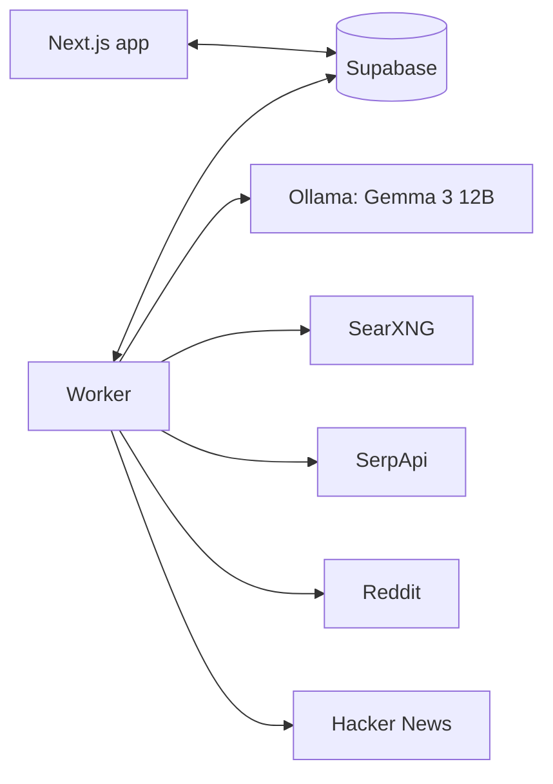

*This is a submission for the [Hacktoberfest Open-Source AI Challenge, Week 3: Slow and Steady](https://dev.to/challenges/hf26).*

## The hook

I built GlamVault, a little app that remembers every makeup product you own so you stop buying the same lipstick twice. Then I did what most indie devs do with marketing: nothing.

The people who need GlamVault exist. They post "is there an app to track my makeup collection?" on Reddit every week. Finding those posts means reading hundreds that aren't them, and writing a reply that helps without sounding like an ad. That's the chore I kept putting off.

So I built Scout and let it do the reading.

## What Scout does

You add your app (name, URL, what it does, who it's for, a few keywords in English and Spanish). You press **Run now**. Then you walk away.

Scout's worker:

1. **Plans** 10–20 search queries with Gemma, written the way people actually post ("forgot I already had this", "compré el mismo labial"), not marketing copy.
2. **Searches** Reddit, Hacker News, SearXNG (self-hosted web search), and Google via SerpApi.
3. **Filters**: drops duplicates, app-store listings, threads older than 30 days (even undated Reddit threads, whose dates it estimates from the post id), and anything that never mentions your keywords.
4. **Scores** every remaining thread with Gemma for relevance and buying intent, and flags authors who are promoting their own app.
5. **Drafts** a reply for the best leads: answer the person first, then one or two honest sentences about your app with "I built this", under 120 words, no link unless the community allows it.
6. **Suggests** places it can't search (TikTok hashtags, Facebook group types, newsletters) with a caption for each.

You come back to an inbox. Edit a draft, copy it, post it yourself, mark it posted. **Scout never posts anything**, and it warns you if you've posted in the same community in the last week.

## The lazy payoff

Real runs from this week (local Gemma 3 12B on my laptop):

| Run | Project | Unattended time | Hits read | Leads kept | Drafts |
|---|---|---|---|---|---|
| Full pipeline | GlamVault | 27 min | 282 | 3 new (+ backlog) | 15 |
| Full pipeline | Sloth Roll | 34 min | 303 | 28 | 15 |
| Search + score only | GlamVault | 10–17 min | 255–288 | 7–30 | – |

My time per run: pressing a button, then <YOUR NUMBER> minutes in the inbox reading and editing drafts.

<PASTE TABLE: time-saved comparison (doing this by hand vs with Scout)>

## Demo

<DEMO VIDEO PLACEHOLDER: 90 seconds, Run now -> runs table -> inbox -> edit, copy, mark posted>

## How it works

The web app never calls a model or a search engine. It queues a run in Postgres; a Node worker polls for queued runs, does everything, and writes leads and drafts back. Every model reply is validated with Zod, retried once if it's malformed, then skipped; one bad answer never kills a run.

Getting lead quality right took most of the week, and it's the part I learned the most from:

- **Run 1 kept brand blogs.** 10 of 11 "leads" were companies' blog posts about makeup organizers. I added a skip list for store pages, a "who wrote this" field, and a keyword gate.
- **Reddit blocked me.** Reddit's public JSON search returns 403 from my network. Its RSS search works at one request a minute, so Scout uses that, then falls back to SerpApi restricted to reddit.com. In my tests, Google also ignored `site:` restrictions whenever a date filter was on.
- **The small model was too generous.** I re-scored the same 42 leads with Gemma 3 4B and 12B. 4B kept a meal-planner launch post and a competitor's "I made an app" thread; 12B rejected both. Scoring is ~3.6x slower on 12B. I picked quality: it runs while I'm not there anyway.
- **Old threads at the top.** Web search returns 2021 Reddit threads with no date. Reddit post ids are base-36 and grow over time, so Scout fits a line through the dated posts in the same run and estimates the rest. A held-out post landed within a day of its real date.
- **Competitors scored 10/10.** For Sloth Roll (my second test app, which turns screenshots into calendar events), the top "leads" were other devs launching screenshot apps. A `self_promo` flag plus a launch-title rule ("I built…", "hice una app") dropped 19 of Sloth Roll's 27 leads as self-promotion, and none of GlamVault's 29.

## Why open innovation matters here

- **It's free to run lazily.** A run is 30–50 model calls. On a hosted API that's a bill every time I press the button; with Gemma on Ollama it's electricity. That's what makes "run it and walk away" a habit instead of a cost decision.
- **Nothing leaves my machine.** My app's positioning, the threads I'm watching, and my drafts never go to a model provider.
- **I could measure and swap.** Models are an env setting behind one interface. When 4B wasn't good enough, I measured 12B on the same data and switched in one line.
- **Self-hostable end to end:** Gemma (open weights), Ollama, SearXNG, Supabase, and Scout itself (MIT).

## Partner tech

- **Gemma (Best Use of Gemma):** Gemma 3 12B does every language step: bilingual query planning, intent and self-promotion scoring as validated JSON, drafting under product rules, and venue ideas.
- **SerpApi (Best Use of SerpApi):** Google results from the past month for web queries, and the Reddit fallback when Reddit says no. Budgeted per run, and skipped cleanly without a key.

## Guardrails

- Never auto-posts; no platform write APIs.
- Every draft discloses "I built this", or it's rejected and rewritten.
- Links only where a community allows them; tracked short links with UTM tags when they do.
- 7-day venue cooldown warning; 3 runs per day.
- Rate-limited, honest reading of every source.
- No pitching fellow builders: launch posts are filtered out.

## What's next

- Hosted open-model inference so runs take minutes, not half an hour.
- More sources: Lemmy, Mastodon, Discourse forums, Stack Exchange.
- Weekly schedules, so the sloth works while I sleep.
- Learning from the drafts I approve and reject.

Code: <REPO LINK PLACEHOLDER> (MIT)

Thanks for reading. Now if you'll excuse me, Scout has some threads to read and I have a nap to take. 🦥
